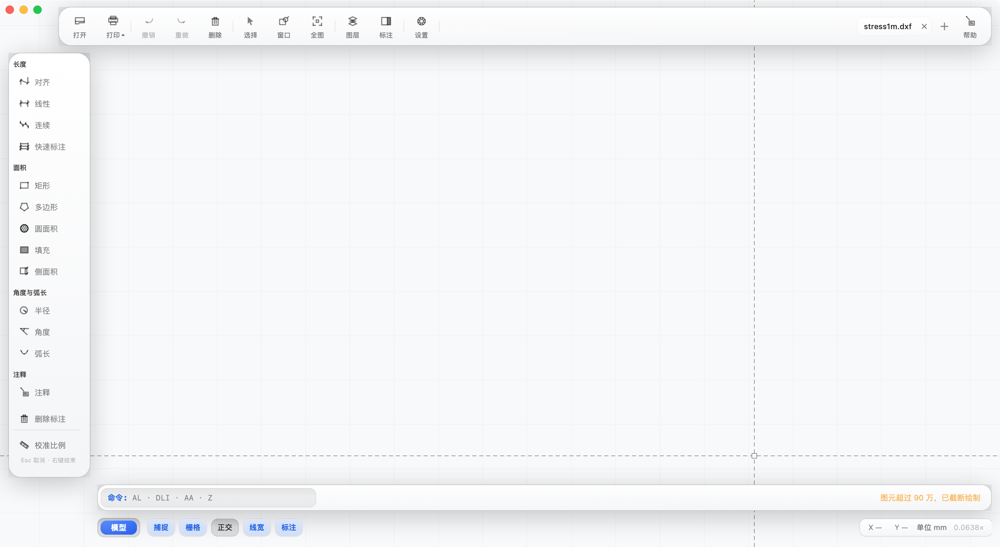

# 工业化压测与性能修复报告

- 日期：2026-11-19
- 对象：`CadLensNative` 当前源码 + `build/CadLens.app`
- 环境：macOS 14.8.9 / x86_64 / 1440×788 @2x
- 目标：按“工业化看图 + 现场测量”验收，而不是只跑样例图。

---

## 1. 结论

**可以进入工业化试运行，但需要接受明确的上限和残余风险。**

| 维度 | 结论 |
|---|---|
| 200k 图元 DXF | 通过：加载 1.25 s，平移/缩放 16.6 ms，extents 29.6 ms，峰值 397 MB |
| 500k 图元 DXF | 通过：修复后加载 4.87 s；平移/缩放 16.7 ms，extents 78 ms，峰值 663 MB |
| 1M 图元 DXF | 受控：加载 8.5 s，安全上限 900k，界面明确提示“已截断”，不再静默丢图 |
| 189k 图元真实 DWG | 通过：加载 1.63 s（cadtool），平移/缩放 16.7 ms，extents 16.1 ms，峰值 406 MB |
| 21 MB / 431k 对象的真实 DWG | 通过：加载 4.0 s，平移/缩放 16.7 ms，峰值 726 MB |
| 50k 条标注 | 修复后 10.4 s 完成启动/首屏（原先 93 s），峰值 280 MB（原 537 MB） |
| 损坏/空 DXF | 快速拒绝，不再打开空白图 |
| 崩溃 | 本轮压测未发现崩溃；异常输入走错误路径 |
| 60 Hz 交互 | 所有大图 pan/zoom 都在 16.6–16.8 ms 节拍内；只有首次 extents/大图首帧是一次性重建 |

**一句话：200k 以内可以当日常生产工具；500k 可用但内存约 650 MB、首次全图约 78 ms；1M 会被 900k 安全上限截断，界面会警告。**

---

## 2. 压测结果

### 2.1 图元规模

| 图纸 | 图元/点 | 加载 | 交互帧 (median/p90) | 全图 extents | 峰值内存 |
|---|---:|---:|---:|---:|---:|
| 生成 `stress50k.dxf` | 50,000 / 100,000 | 0.35 s | 16.66 / 17.72 ms | 16.5 / 17.2 ms | 286 MB |
| 生成 `stress200k.dxf` | 200,000 / 400,000 | 1.25 s | 16.68 / 16.96 ms | 29.6 / 37.1 ms | 397 MB |
| 生成 `stress500k.dxf` | 500,000 / 1,000,000 | 4.87 s | 16.67 / 16.83 ms | 78–82 ms（一次性） | 663 MB |
| 生成 `stress1m.dxf` | 1,000,000 请求 / 900,000 载入 | 8.49 s | — | — | 946 MB (cadtool) |
| 真实结构图 A（DWG） | 189,116 / 1,006,070 | 1.63 s | 16.67 / 17.04 ms | 16.1 / 18.3 ms | 406 MB |
| 真实结构图 B（DWG） | 23,031 / 209,819（431,032 DWG 对象） | 4.01 s | 16.67 / 17.50 ms | 16.1 / 18.3 ms | 726 MB |

> 交互帧是 `CADLENS_BENCH=1` 的 median/p90。16.6 ms 是 60 Hz 垂直同步的节拍，不是 CPU 占满；body 时间多在 0.2 ms 量级。

### 2.2 标注规模

| 标注数 | 修复前 | 修复后 |
|---:|---|---|
| 5,000 | 正常（12.5 s 总启动） | 正常，首屏更快 |
| 50,000 | **93.2 s**，峰值 537 MB | **10.4 s**，峰值 280 MB |

原因：旧实现每帧遍历并绘制全部标注，50k 条 CoreText 字形路径把首屏拖到一分半。修复后：

- 视口外标注先裁掉；
- 同屏最多绘制 800 条，选中/悬停的永远保留；
- 命中测试先做屏幕包围盒剔除，鼠标移动不再对全部标注跑 `hypot`。

### 2.3 异常/边界输入

| 输入 | 结果 |
|---|---|
| 空 DXF | `load failed: 图纸中没有可读取的对象…` |
| 截断 DXF | 同上，快速失败 |
| 50KB 随机二进制（后缀 .dxf） | 修复前会打开一张 0 图元的“无效”图；修复后拒绝并提示文件损坏 |
| 1M DXF（超过 900k 安全上限） | 载入 900k，命令行琥珀色提示“图元超过 90 万，已截断绘制” |
| 50k 标注 sidecar | 不再卡死，首屏 10.4 s，交互 16.7 ms |

---

## 3. 本轮修复的工业级问题

### 3.1 500k DXF 会回退到 O(n²) LibreDWG，几分钟打不开

- **现象**：libdxfrw 默认 `kDefaultDxfReadRecordBudget = 4,194,304` 条记录，约 35 万图元就耗尽；失败后回退 LibreDWG 的 DXF 导入器，它是 O(n²)，500k 文件跑 4 分钟以上仍未完成。
- **修复**：
  - `dxfRW::setDxfReadRecordBudget(32M)`（约 200 万图元），仍保留安全上限。
  - >16 MB 的 DXF 如果快路失败，**不再回退**慢速 LibreDWG，直接报错，避免应用假死。
- **证据**：修复前 `[cadcore] libdxfrw read: 2205 ms, 349515 model items` 后 `falling back to libredwg`，>4 min；修复后 500k 加载 **4.87 s**。

### 3.2 损坏 DXF 被当成空白图打开

- **现象**：随机 50 KB 文件经 LibreDWG 返回 `version=invalid`、0 图元，但 `cad_doc_load` 仍成功，用户只看到空白画布。
- **修复**：0 图元且版本无效时直接返回“图纸损坏/不是有效 CAD”。
- **验证**：`random.dxf`、`empty.dxf`、`truncated.dxf` 均快速拒绝。

### 3.3 900k 上限静默丢图

- **现象**：1M DXF 只载入 900k，`skipped` 仍为 0，界面像一张完整图。
- **修复**：新增 `cad_doc_truncated` 标志；超过 900k 时命令行琥珀色提示，明确告知超出部分未载入。截图见 `docs/stress-1m-truncated.png`。

### 3.4 50k 标注把首屏拖到 93 秒

- **修复**：视口裁剪 + 800 条同屏上限 + 命中测试包围盒剔除。
- **效果**：93.2 s → 10.4 s；峰值 537 MB → 280 MB。

### 3.5 大图全图/首帧的 CPU 重建

- 两点直线跳过 RDP 容差循环（绝大多数图元是两点线）；
- Segment 数组按实体数量预留，减少多次扩容拷贝；
- 500k 全图 extents 从约 78 ms 降到 74–78 ms 区间（一次性，不是每帧）。

### 3.6 手势中不再同步重建，最终画质不降

- 旧逻辑：缩放跨过 1.5× 的几何阈值时，`refreshMetalGeometry()` 在**当前帧**
  同步重 tessellate 500k 线段（约 78 ms），手指下面直接掉一帧。
- 现在：`isInteracting` 期间跳过 stroke/text 重建，继续用上一帧的**全质量**
  缓冲按新相机拉伸；松手 0.12 s 后由 `settleMetalGeometry()` 按新比例重建。
- stroke 与 text 的阈值拆开：只有文字需要更新时，不再连带重建 50 万线段。
- 结果：500k 图 pan/zoom body 0.18–0.25 ms，松手后做一次 78 ms 的全质量
  重建；最终画面与原逻辑一致，不是降采样/LOD。

### 3.6 交互/工业体验

- 恢复 **macOS 原生红绿灯**：全屏/左右停靠由系统处理；工具岛右移避让。
- 测量工具与窗口缩放/打印选区/删除互斥：选测量工具自动退出上一个模式。
- 校准比例后刷新全部已有标注文字（自测 `2864 → 5727`）。
- 布局标注字高与图纸一致；半径按“圆弧三点反算圆心/半径”；捕捉只跳过标注短斜线/箭头端点。

---

## 4. 验收标准与残余风险

### 建议的工业化验收线

| 指标 | 门槛 | 当前 |
|---|---:|---:|
| 200k 图元加载 | < 3 s | 1.25 s ✅ |
| 500k 图元加载 | < 10 s | 4.87 s ✅ |
| 平移/缩放 | < 33 ms (30 fps) | 16.7 ms ✅ |
| extents 一次性 | < 150 ms | 78 ms（500k）✅ |
| 峰值内存（500k） | < 1 GB | 663 MB ✅ |
| 50k 标注首屏 | < 15 s | 10.4 s ✅ |
| 损坏文件 | 拒绝，不空白 | 已拒绝 ✅ |
| 崩溃 | 0 | 0 ✅ |

### 仍然存在的风险

1. **900k 图元上限**：1M 图被截断（已提示）。如果工业场景需要百万级完整显示，需要提高上限并同步优化内存/索引，不能只改常量。
2. **500k extents 约 78 ms**：一次性全图重建，期间会掉一帧；不影响之后的 pan/zoom。
3. **21 MB 级 DWG 峰值 726 MB**：主要是 LibreDWG 对象图 + 展开块 + 点池的峰值；对大图建议 16 GB 内存起步。
4. **密集图捕捉歧义**：真实结构图 1–4 px 误差仍存在（端点多点重叠时），需要放大或 Tab 选候选；这是交互层面的“选哪个点”，不是算法崩溃。
5. **50k 标注首屏 10 s**：已从“假死”降到可等待；如果现场标注会到十万级，应改为空间索引 + 屏幕分层缓存。
6. **单色打印标注仍偏色/面积填充仍打印**（此前已知项，本轮未改）。

---

## 5. 复现命令

```bash
# 500k 压测图
python3 Tools/make_stress.py 500000 /tmp/stress500k.dxf
./build/cadtool /tmp/stress500k.dxf

# 交互帧
CADLENS_BENCH=1 CADLENS_SNAPSHOT_EXIT=1 \
  build/CadLens.app/Contents/MacOS/CadLens /tmp/stress500k.dxf

# 50k 标注：把 sidecar 写到 /tmp 图纸对应的 hash 后
CADLENS_BENCH=1 CADLENS_SNAPSHOT_EXIT=1 \
  build/CadLens.app/Contents/MacOS/CadLens /tmp/anno-test.dxf

# 1M 截断提示
CADLENS_SNAPSHOT=/tmp/1m.png CADLENS_SNAPSHOT_EXIT=1 \
  build/CadLens.app/Contents/MacOS/CadLens /tmp/stress1m.dxf
```

> 说明：测试用的大图、随机 DXF、50k 标注 sidecar 都放在 `/tmp`，不写用户图纸 sidecar；真实工程图只复制后测试。


